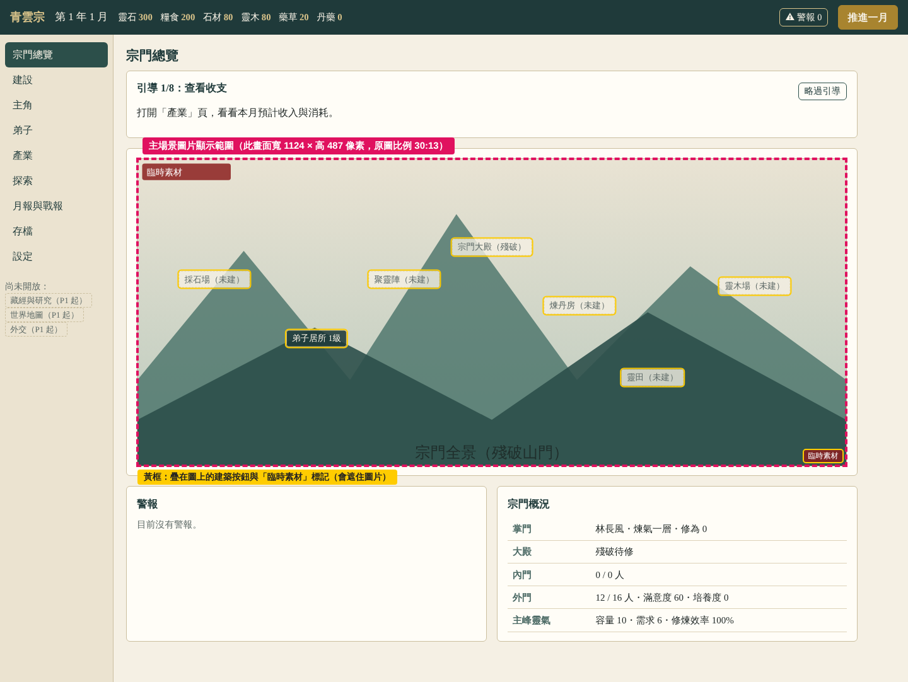

# 插圖製作需求

依 P0 程式（分支 `claude/p0`）實際畫面整理，量測日期 2026-10-18。

> 2026-10-18 已換上第 1 版正式圖（見 [素材清單](素材清單.md)），宗門總覽的按鈕座標也已依新全景調整。下方 §三之一 的截圖與座標表是換圖前臨時圖的版本，留作規格參考。尺寸數字是用瀏覽器在 1280、1440、1920 寬的視窗實測；「建議」欄位是建議值，不是程式限制。

## 一、美術方向（暫定）

- 精緻國風、青綠山水場景、細緻建築與自然光影。
- 圖片內**不放文字、按鈕、印章字、標題或邊框**。遊戲會自己在圖上疊字與按鈕。
- 初始宗門：衰敗、可修復，但仍保有修仙山門的氣勢（例如殿宇屋瓦殘缺、石階長草、雲霧與遠山依然壯闊）。

## 二、素材總表

目前共 11 張臨時圖，全部放在 `assets/placeholder/`，由 `tools/make-placeholders.ts` 產生。

| # | 素材 | 臨時檔案 | 使用頁面與用途 | 目前原圖 | 實際顯示大小 | 建議交付尺寸 | 長寬比 | 透明背景 |
|---|---|---|---|---|---|---|---|---|
| 1 | 宗門全景（主場景） | `assets/placeholder/panorama.svg` | ①宗門總覽頁主圖，上面疊 7 個建築按鈕　②標題畫面主視覺 | 1200×520 | 總覽：最寬 1124×487（1280 寬視窗為 1024×444）；標題：最寬 558×242 | **2400×1040** | 30:13（約 2.31:1） | 不需要 |
| 2 | 宗門大殿 | `assets/placeholder/hall.svg` | 建設頁「宗門大殿」卡片頂部 | 480×300 | 242×151 ～ 307×192（視窗窄時單欄可到約 500 寬） | **960×600** | 16:10 | 不需要 |
| 3 | 弟子居所 | `assets/placeholder/dorm.svg` | 建設頁卡片 | 480×300 | 同上 | **960×600** | 16:10 | 不需要 |
| 4 | 靈田 | `assets/placeholder/field.svg` | 建設頁卡片 | 480×300 | 同上 | **960×600** | 16:10 | 不需要 |
| 5 | 採石場 | `assets/placeholder/quarry.svg` | 建設頁卡片 | 480×300 | 同上 | **960×600** | 16:10 | 不需要 |
| 6 | 靈木場 | `assets/placeholder/lumber.svg` | 建設頁卡片 | 480×300 | 同上 | **960×600** | 16:10 | 不需要 |
| 7 | 煉丹房 | `assets/placeholder/alchemy.svg` | 建設頁卡片 | 480×300 | 同上 | **960×600** | 16:10 | 不需要 |
| 8 | 聚靈陣 | `assets/placeholder/array.svg` | 建設頁卡片 | 480×300 | 同上 | **960×600** | 16:10 | 不需要 |
| 9 | 荒廢洞府（秘境） | `assets/placeholder/cave.svg` | 探索頁「準備」畫面左欄，右側是秘境說明 | 800×360 | 520×234 ～ 570×257（窄視窗單欄約 650 寬） | **1600×720** | 20:9 | 不需要 |
| 10 | 男修肖像（主角） | `assets/placeholder/portrait-male.svg` | 主角頁左欄，主角性別為男時顯示 | 240×300 | 固定 218×273 | **960×1200** | 4:5 | 建議不需要（見 §四） |
| 11 | 女修肖像（主角） | `assets/placeholder/portrait-female.svg` | 主角頁左欄，主角性別為女時顯示 | 240×300 | 固定 218×273 | **960×1200** | 4:5 | 建議不需要（見 §四） |

建議交付尺寸約為最大顯示寬度的 2 倍，讓高解析度螢幕（手機、Mac）也清楚。比例請與「長寬比」欄完全一致。

## 三、裁切與遮擋

**目前程式不會裁切圖片。** 圖片一律縮放到容器寬度、高度依原比例自動計算（`src/ui/theme/theme.css` 的 `.art img { width: 100%; height: auto; }`）。所以：

- 交付圖的比例會直接改變畫面高度，比例不同時版面會變高或變矮，主場景上的按鈕位置也會跑掉。請照表上比例交付。
- 四角有 6 像素圓角、1 像素外框，最邊緣幾像素會被修掉，重要內容請離邊緣至少 2%。
- 臨時圖右下角會出現紅色「臨時素材」小標，路徑改成正式素材後就不會顯示。

各圖被文字或介面遮住的位置：

| 素材 | 疊在圖上的東西 | 建議 |
|---|---|---|
| 宗門全景（總覽頁） | 7 個建築名稱按鈕（見下方截圖與 §三之一座標表） | 按鈕位置附近畫出對應建築或其「預定地」，但主體輪廓不要只靠被按鈕蓋住的那一小塊表現 |
| 宗門全景（標題畫面） | 無。上方是遊戲名稱、下方是按鈕，都在圖外 | 縮到 558 寬仍要看得出山門主體，構圖重心放中央 |
| 建築 7 張 | 無。名稱、等級、說明都在圖下方 | 主體置中，四周留一點空間 |
| 荒廢洞府 | 無。說明在右欄 | 洞口置中偏下即可 |
| 肖像 2 張 | 無。角色資料在右欄 | 頭部約在上方 1/3，臉不要貼邊 |

### 三之一、宗門總覽截圖與主場景範圍

實際畫面（1440×900 視窗，開新局第 1 年 1 月）。**紅色虛線框**是主場景圖片的顯示範圍；**黃框**是疊在圖上的建築按鈕與「臨時素材」標記。

未標註的原始截圖：[宗門總覽-原始.png](screenshots/宗門總覽-原始.png)

建築按鈕是以按鈕中心對齊下表座標（程式在 `src/ui/pages/Overview.tsx` 的 `SPOTS`）。下表已換算成「圖片上的位置」，並換算到 2400×1040 交付圖的像素。每個按鈕約佔圖寬 9～11%、圖高 5.5%；文字變長（例如「宗門大殿 1級・施工中」）時會再加寬。

| 建築 | 圖上水平位置 | 圖上垂直位置 | 2400×1040 圖上的中心點 | 開局狀態 |
|---|---|---|---|---|
| 宗門大殿 | 50.0% | 28.5% | (1200, 297) | 殘破 |
| 弟子居所 | 25.2% | 58.4% | (606, 608) | 1 級 |
| 靈田 | 72.7% | 71.3% | (1745, 741) | 未建 |
| 採石場 | 10.8% | 39.2% | (259, 408) | 未建 |
| 靈木場 | 87.2% | 41.4% | (2092, 430) | 未建 |
| 煉丹房 | 62.4% | 47.8% | (1497, 497) | 未建 |
| 聚靈陣 | 37.6% | 39.2% | (903, 408) | 未建 |

座標是依目前臨時圖排的，構圖若需要，按鈕座標可以改程式配合正式圖，交圖時附上每棟建築的大略中心點即可。

## 四、替換圖片注意事項

1. **全景是同一張靜態圖**：建築升級或新建時全景不會換圖。所以初始衰敗感要靠「殘破但可修」表現，未建的位置畫成空地、舊基址、荒廢梯田之類的預定地，玩家蓋好之後看起來也不違和。日後想讓全景隨建設變化，需要另外開發（分層圖或多張狀態圖）。
2. **建築卡片每棟只有一張圖**，殘破、1 級、高等級都用同一張。建議畫「已修復、正常運作」的樣子；宗門大殿開局是殘破，若想要殘破版，需要另外加程式支援。
3. **肖像目前只給主角用**，弟子沒有肖像。框是長方形且有底色，所以建議畫完整背景（淡雲霧或素色）。若之後要做去背立繪，可另外保留一份透明背景原檔。
4. **檔案格式**：程式只讀 `.png`、`.webp`、`.jpg`、`.svg`，副檔名須小寫，`.jpeg` 不會被讀到。建議用 `.webp`（檔案小），全景控制在約 600 KB 內、其他每張約 200 KB 內（建議值）。
5. **放置位置與命名**：正式圖放 `assets/final/`，檔名建議沿用臨時圖名稱（例如 `assets/final/panorama.webp`），檔名用英文小寫。
6. **換圖需要改的地方**（下一步由程式處理，本次未改）：
   - 建築 7 張：`src/content/buildings/index.ts` 各建築的 `art`
   - 荒廢洞府：`src/content/secret-realms/abandoned-cave.ts` 的 `art`
   - 全景：`src/ui/pages/Overview.tsx`、`src/ui/pages/Title.tsx`
   - 肖像：`src/ui/pages/Protagonist.tsx`
   - 路徑不再以 `placeholder/` 開頭後，「臨時素材」標記會自動消失。
7. **授權紀錄**：每張正式圖都要在 [素材清單](素材清單.md) 記錄作者、來源與授權（企畫書 §16）。
8. **建議先做樣稿**：先交宗門全景一張，放進遊戲看按鈕疊上去的效果，確認風格後再做其餘 10 張。
